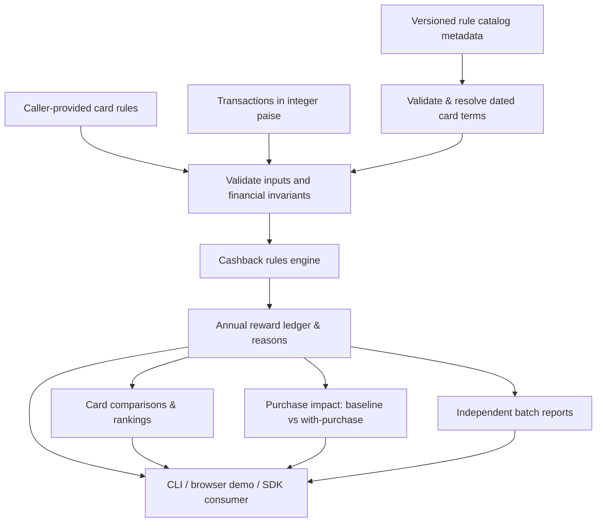

# Architecture and engineering decisions

CredoRewards Engine is a **deterministic TypeScript library**, not a connected banking application. It accepts caller-provided card rules and transaction data and produces auditable synthetic or independently sourced what-if calculations.

## Component map



No live issuer/merchant data, bank connection, hosted financial API or account store is part of this library. The local dashboard calls the same compiled SDK as consumers. The static deployment contains allowlisted JavaScript and HTML only.

## Source directory guide

| Location | Responsibility |
| --- | --- |
| `src/index.ts` | Public typed SDK exports, `calculateRewards()`, card comparison and validated financial primitives |
| `src/purchase-impact.ts` | Marginal impact using **two runs of the existing engine**, not a second formula |
| `src/batch.ts` | Independent multi-scenario comparisons and calendar-month reporting |
| `src/catalog.ts`, `src/catalog-audit.ts` | Catalog validation, date resolution and change auditing |
| `src/statement-cycles.ts` | Assumed statement-cycle spend grouping; intentionally separate from cashback math |
| `schemas/` | Bundled rule-catalog JSON Schema authoring contract |
| `bin/` | CLI entrypoints (single-card, catalog, batch) |
| `web/` | Synthetic browser demo, exact currency rendering and local JSON import |
| `scripts/` | Catalog fixture validation, loopback-only preview, allowlisted static output |
| `tests/` | Cross-platform Node test suite, financial edge cases, browser distribution and package smoke tests |
| `.github/workflows/` | CI, maintenance and carefully gated release/publishing automation |
| `docs/` | User contracts, governance and operational limitations |

## Financial invariants

1. **No floating-point currency calculations.** Inputs are non-negative safe integer paise. Multiplication and cap tracking use `bigint`, with explicit safe-range validation before returning numbers.
2. **Deterministic outputs.** Transaction processing sorts by calendar month and ID; card rankings use stable ID tie-breaking.
3. **Fail closed.** Invalid card terms, duplicate transaction identifiers, invalid months, out-of-range rates and unsafe cumulative amounts throw rather than silently producing a plausible answer.
4. **Caps are per rule.** Minimums, first-match-wins rule precedence, monthly and annual caps and exclusions must remain covered by regression tests.
5. **Clear attribution.** Results include transaction-level reasons; purchase-impact reports distinguish the proposed purchase's own cashback from **net change in annual cashback** after cap displacement.
6. **Independent comparisons.** `compareCards()`, `comparePurchaseImpact()` and batch analysis **assume all historical spend belongs to each evaluated card independently**. They do not allocate a real wallet's purchases or determine a safe merchant-specific card choice.
7. **Complete-year fee assumption.** Fee waiver and net annual estimates are valid only for complete-year inputs under accurate caller-supplied terms. The engine does not infer issuer fees, taxes, effective midyear terms or rewards-point values.
8. **Input immutability.** SDK functions must not mutate caller-owned arrays or card rules.

See [Reward rules](RULE-SCHEMA.md), [Card comparison](CARD-COMPARISON.md) and [Purchase impact](PURCHASE-IMPACT.md) for detailed contracts.

## Data provenance and trust boundaries

Rule-catalog metadata supports evidence URLs, effective dates and review status, but **a recorded review status or link is not proof of issuer verification**. Do not package current Indian bank rates without independently reviewing first-party terms, card variants, effective dates, relevant MCC rules and legal reuse permissions. Real banking/cardholder data must not enter public fixtures, logs or issues.

The **browser demo** only handles fictional JSON or explicitly caller-provided test data locally, displays dynamic text using safe text nodes and is served by a restrictive CSP. Its localhost HTTP preview binds to `127.0.0.1` and is not designed as a public multi-user server. Vercel deployment readiness must be verified separately from public accessibility.

## Testing and release architecture

```text
Feature branch -> Reviewable pull request
               -> GitHub CI: 5 jobs (Ubuntu/Windows, Node 24/26, npm variants)
               -> Source tests + package installation smoke + schema checks
               -> Merge gate on exact head SHA
               -> Protected main
               -> Independently gated prerelease / npm publishing (not implied by merge)
```

```bash
npm ci --ignore-scripts
npm run typecheck
npm test
npm run test:package
npm run validate:catalog
npm run build:web
```

The `verify:release` script runs a consolidated source/package preflight; it does not itself grant publication approval. Do not bypass branch protection, modify secrets, change npm tags or publish financial claims as part of routine contribution.

## Known non-goals for this alpha

- Real-time bank or merchant APIs, payment processing or storing cardholder data.
- Authenticating official issuer terms automatically.
- Reward-point redemption valuation, accelerated tiers or live personalized offers.
- Precise multi-card wallet spend allocation, posted-date and billing-period financial calculations.
- A stable production compatibility guarantee.

For the authoritative decision on launch readiness and remaining security work, see [Production readiness](PRODUCTION-READINESS.md); planned capabilities are in [Roadmap](ROADMAP.md).
